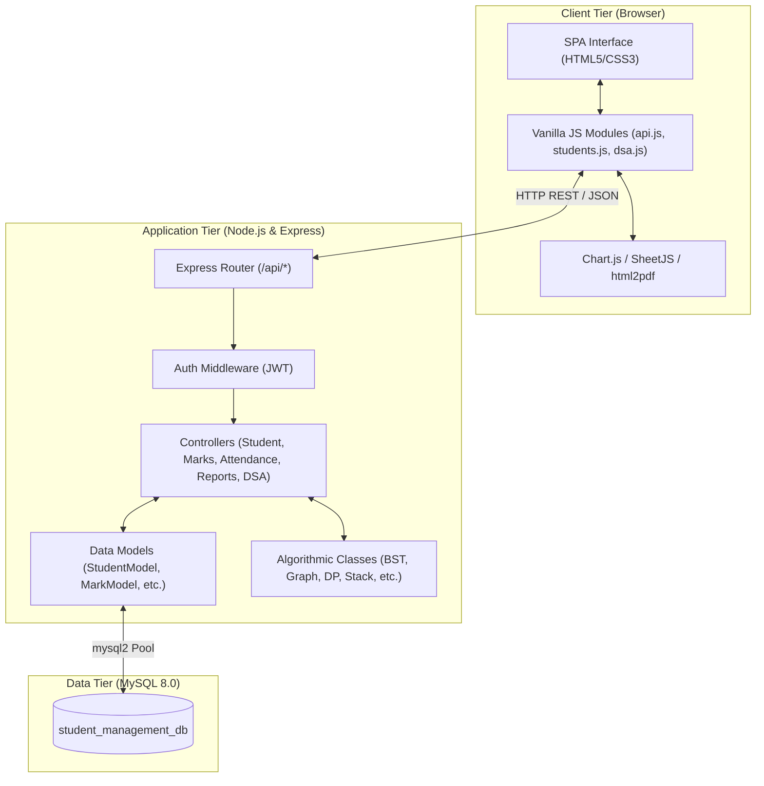
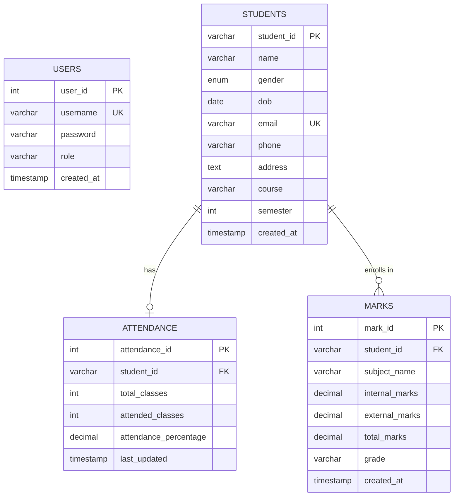
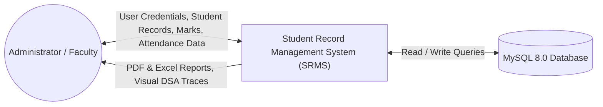
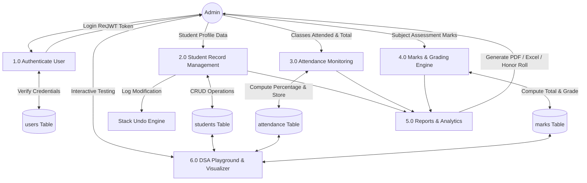

# PROJECT REPORT
## STUDENT RECORD MANAGEMENT SYSTEM (SRMS)
### A Web-Based Platform Integrating Data Structures & Algorithmic Techniques

**Student Name**: DIVYA SUNDAR  
**Register Number**: 26MCAB18  
**Programme / Class**: Master of Computer Applications (MCA)  
**Course Name**: Data Structures and Algorithmic Techniques  
**Faculty Guide**: Prof. Abinaya S  
**Department**: Kristu Jayanti Institute of Technology  
**Academic Year**: 2026–2027  
**Technology Stack**: HTML5, CSS3, Vanilla JavaScript, Node.js, Express.js, MySQL 8.0  

---

## TABLE OF CONTENTS
1. [Abstract](#1-abstract)
2. [Introduction & Problem Statement](#2-introduction--problem-statement)
3. [Project Objectives & Scope](#3-project-objectives--scope)
4. [Software Requirements Specification (SRS)](#4-software-requirements-specification-srs)
5. [System Architecture & Design Patterns](#5-system-architecture--design-patterns)
6. [Database Design & Normalization](#6-database-design--normalization)
7. [Data Flow Diagrams (DFD)](#7-data-flow-diagrams-dfd)
8. [Data Structures & Algorithmic Techniques Implementation](#8-data-structures--algorithmic-techniques-implementation)
   - 8.1 Singly Linked List (Dynamic Record Management)
   - 8.2 Stack (Undo Mechanism)
   - 8.3 Queue (Student Registration FIFO)
   - 8.4 Binary Search Tree (Student ID Indexing)
   - 8.5 Graph with BFS & DFS (Academic Hierarchy)
   - 8.6 Searching Algorithms (Linear & Binary Search)
   - 8.7 Sorting Algorithms (Adaptive Bubble Sort)
   - 8.8 Greedy Algorithm (Merit Scholarship Selection)
   - 8.9 Dynamic Programming (Performance Trend Analysis - LIS)
   - 8.10 Backtracking Algorithm (Course Prerequisite Validation)
9. [REST API Specification](#9-rest-api-specification)
10. [User Interface Design](#10-user-interface-design)
11. [Testing & Verification](#11-testing--verification)
12. [Conclusion & Future Enhancements](#12-conclusion--future-enhancements)
13. [References](#13-references)

---

## 1. ABSTRACT

Educational institutions require reliable, scalable, and intuitive management systems to track student demographics, attendance percentages, and examination grades while generating analytical reports. Simultaneously, understanding how fundamental computer science data structures and algorithmic strategies apply to real-world software engineering is a core pillar of graduate computer applications curricula.

This mini project presents the **Student Record Management System (SRMS)**, a full-stack client-server web application built using **Node.js, Express.js, Vanilla JavaScript, HTML5/CSS3, and MySQL 8.0**. In addition to providing robust administrative capabilities (CRUD operations, automatic attendance percentage computation, automated letter grade assignment, and report exports to PDF and Excel), the system integrates a dedicated **Data Structures & Algorithms (DSA) Playground**. Ten fundamental DSA concepts—including Linked Lists, Stacks for Undo operations, Queues for registration processing, Binary Search Trees for ID indexing, Graph traversals (BFS/DFS), Searching algorithms, Adaptive Sorting, Greedy choice scholarship allocations, Dynamic Programming for progression analysis, and Backtracking for prerequisite validation—are implemented in clean, modular JavaScript classes on the server and visualized interactively on the client.

---

## 2. INTRODUCTION & PROBLEM STATEMENT

### 2.1 Background
Conventional academic record management frequently relies on manual spreadsheets, disparate databases, or siloed administrative tools that lack integration, automated grading, and real-time analytical reporting. Furthermore, in computer science education, data structures and algorithms are often taught as isolated theoretical paradigms in console programs, leaving students with limited exposure to how data structures function inside modern web application architectures.

### 2.2 Problem Statement
Design, engineer, and deploy a comprehensive web application that:
1. Enables administrators to record, update, query, and delete student demographic records with input validation.
2. Automates attendance calculations and alerts faculty to attendance defaulters ($< 75\%$).
3. Automates total marks calculations and assigns letter grades based on predefined institutional grading rubrics ($90+ \to \text{A+}$, $80+ \to \text{A}$, $70+ \to \text{B+}$, $60+ \to \text{B}$, $50+ \to \text{C}$, $< 50 \to \text{F}$).
4. Provides instant export of administrative reports to PDF and Microsoft Excel format.
5. Implements and visualizes 10 core Data Structures and Algorithmic Techniques within the operational context of student record management.

---

## 3. PROJECT OBJECTIVES & SCOPE

### 3.1 Primary Objectives
- **Administrative Efficiency**: Eliminate paper-based workflows by providing a centralized database interface for student records.
- **Accurate Academic Evaluation**: Automatically compute attendance ratios and cumulative marks while mapping letter grades with zero manual calculation errors.
- **Algorithmic Practicality**: Demonstrate how classical computer science algorithms directly solve operational problems (e.g., Stack for Undo, Greedy for Scholarship grants, Dynamic Programming for semester trajectory tracking).
- **Extensible Architecture**: Provide modular REST APIs with separation of concerns across Models, Controllers, Routes, and Services.

### 3.2 Scope
- **Target Users**: Academic department administrators, faculty members, and academic counselors.
- **Supported Academic Programs**: MCA, M.Tech, Data Science, AI & ML, B.Tech CSE.
- **Deployment**: Standalone web application accessible through standard web browsers on desktop, laptop, and tablet devices.

---

## 4. SOFTWARE REQUIREMENTS SPECIFICATION (SRS)

### 4.1 Functional Requirements
1. **User Authentication**: Secure administrative login with username, password, session token generation, and logout.
2. **Student Management**:
   - Add new student profile (ID, Name, Gender, DOB, Email, Phone, Address, Course, Semester).
   - Edit student demographics with instant updates.
   - Delete student profile with automatic cascading foreign key deletion of linked attendance and marks.
   - View detailed student dossier with combined demographic, attendance, and subject marks tables.
   - Live search filter by name, ID, or email, with course filter and multi-column sorting.
3. **Attendance Management**:
   - Record total classes held and classes attended.
   - Automatically compute $\text{Attendance Percentage} = (\text{Attended} / \text{Total}) \times 100$.
   - Highlight defaulters ($< 75\%$) and scholarship-eligible attendees ($> 85\%$).
4. **Marks & Grading Management**:
   - Record subject-wise internal marks (out of 30) and external marks (out of 70).
   - Automatically compute $\text{Total Marks} = \text{Internal} + \text{External}$.
   - Automatically assign letter grade ($90+ \to \text{A+}$, $80+ \to \text{A}$, $70+ \to \text{B+}$, $60+ \to \text{B}$, $50+ \to \text{C}$, $< 50 \to \text{F}$).
5. **Reporting & Document Export**:
   - Generate Student Summary, Attendance Defaulter List, Marks Distribution, Dean's Honor Roll, and Scholarship Recipient lists.
   - Export documents directly as styled PDFs and `.xlsx` Excel spreadsheets.
6. **Data Structures & Algorithms Module**:
   - Interactive visualizers for Linked List, Stack, Queue, BST, Graph, Linear Search, Binary Search, Bubble Sort, Greedy Scholarship, Dynamic Programming, and Backtracking.

### 4.2 Non-Functional Requirements
- **Performance**: API response times under 50 milliseconds for database queries.
- **Reliability**: Zero data corruption; atomic operations and foreign key cascade integrity.
- **Usability**: Responsive glassmorphism interface with dark mode toggle and zero page reloads (SPA).
- **Portability**: Operates uniformly across Windows, Linux, and macOS environments.

---

## 5. SYSTEM ARCHITECTURE & DESIGN PATTERNS

The application is architected around the **3-Tier Client-Server Architecture** utilizing the **Model-View-Controller (MVC)** design pattern on the backend.



---

## 6. DATABASE DESIGN & NORMALIZATION

### 6.1 Entity-Relationship (ER) Diagram



### 6.2 Relational Schema & Constraints
1. **`students`**: Primary entity storing academic profile. Primary Key is `student_id`.
2. **`attendance`**: Foreign key `student_id` references `students(student_id)` with `ON DELETE CASCADE ON UPDATE CASCADE`.
3. **`marks`**: Foreign key `student_id` references `students(student_id)` with `ON DELETE CASCADE ON UPDATE CASCADE`.
4. **`users`**: Administrative credentials with unique username index.

### 6.3 Normalization
- **1NF**: All table attributes are atomic. No multi-valued repeating groups.
- **2NF**: All non-key attributes are fully functionally dependent on the entire primary key.
- **3NF**: No transitive dependencies exist. Calculated values like `attendance_percentage` and `total_marks` are defined as `GENERATED ALWAYS AS ... STORED` columns directly within the database engine.

---

## 7. DATA FLOW DIAGRAMS (DFD)

### 7.1 DFD Level 0 (Context Diagram)



### 7.2 DFD Level 1



---

## 8. DATA STRUCTURES & ALGORITHMIC TECHNIQUES IMPLEMENTATION

### 8.1 Singly Linked List (Dynamic Record Management)
- **Concept**: A dynamic chain of `ListNode` objects where each node holds a student record object and a reference pointer `next` to the succeeding node.
- **Operations**:
  - `insertHead(student)`: Prepends a student in $O(1)$ time.
  - `insertTail(student)`: Appends a student in $O(1)$ time using a tail pointer.
  - `deleteById(studentId)`: Unlinks the matching student node in $O(n)$ time.
  - `traverse()`: Walks from `head` to `tail`, generating the ordered list and inspection logs.
- **Complexity**: Time: Insert $O(1)$, Delete $O(n)$, Search $O(n)$; Space: $O(n)$.

### 8.2 Stack (Undo Mechanism)
- **Concept**: Implements a Last-In, First-Out (LIFO) stack of maximum depth $K=50$ storing historical action frames.
- **Operations**:
  - `push(action)`: Pushes the prior state of a modified or deleted student into the stack in $O(1)$ time.
  - `pop()`: Pops the most recent state frame in $O(1)$ time.
  - `undoLastAction()`: Evaluates the popped frame type (`INSERT`, `UPDATE`, or `DELETE`) and executes the compensating rollback database query.
- **Complexity**: Time: $O(1)$ for push, pop, peek; Space: $O(K)$.

### 8.3 Queue (Student Registration FIFO)
- **Concept**: Implements a First-In, First-Out (FIFO) queue for incoming student applicants waiting for verification and registration.
- **Operations**:
  - `enqueue(applicant)`: Generates a unique tracking ticket (e.g. `REG-2490`) and places the applicant at the rear in $O(1)$ time.
  - `dequeue()`: Extracts the applicant at the front of the queue, marks their status as "Approved & Registered", and returns remaining queue count in $O(1)$ time.
- **Complexity**: Time: $O(1)$ enqueue/dequeue; Space: $O(n)$.

### 8.4 Binary Search Tree (Student ID Indexing)
- **Concept**: A non-linear tree data structure where each node stores a student record keyed by numeric or alphanumeric Student ID. For every node, all keys in its left subtree are strictly smaller, and all keys in its right subtree are strictly greater.
- **Operations**:
  - `insert(student)`: Traverses left or right down the tree to position the new node in $O(\log n)$ average time.
  - `search(studentId)`: Compares target ID against current node key, branching left or right and recording comparison steps until found or reaching null in $O(\log n)$ time.
  - `delete(studentId)`: Unlinks leaf nodes, bypasses single-child nodes, or replaces two-child nodes with their inorder successor.
  - `inorderTraversal()`: Recursively visits Left $\to$ Root $\to$ Right, producing a sorted sequence of all students by ID.
- **Complexity**: Time: Search/Insert/Delete $O(\log n)$ average, $O(n)$ worst-case; Space: $O(n)$.

### 8.5 Graph with BFS & DFS (Academic Hierarchy)
- **Concept**: Directed acyclic graph using an Adjacency List representing the structural university hierarchy:
  $$\text{Apex University} \longrightarrow \text{Departments} \longrightarrow \text{Courses} \longrightarrow \text{Students}$$
- **Operations**:
  - `bfs(startNode)`: Uses a FIFO queue to discover vertices level by level, logging queue enqueue and dequeue operations.
  - `dfs(startNode)`: Uses call-stack recursion (LIFO) to traverse deeply down a single course branch before backtracking.
- **Complexity**: Time: $O(V + E)$ where $V$ is number of academic entities and $E$ is number of affiliation edges; Space: $O(V)$.

### 8.6 Searching Algorithms
1. **Linear Search**:
   - Examines records sequentially from index $0$ to $n-1$ for case-insensitive student name matches.
   - Best Case: $O(1)$; Average & Worst Case: $O(n)$; Space: $O(1)$.
2. **Binary Search**:
   - Operates on a sorted array of student IDs by maintaining `low`, `mid`, and `high` pointers, halving the search space in each iteration:
     $$\text{mid} = \left\lfloor \frac{\text{low} + \text{high}}{2} \right\rfloor$$
   - Best Case: $O(1)$; Average & Worst Case: $O(\log n)$; Space: $O(1)$.

### 8.7 Sorting Algorithms (Adaptive Bubble Sort)
- **Concept**: Iteratively steps through the student array, comparing adjacent elements and swapping them if out of order.
- **Adaptive Optimization**: Tracks a boolean flag `swapped`. If an entire pass completes without a single swap, the list is already sorted, terminating early.
- **Fields Supported**: Student Names (alphabetical), Attendance Percentage (numerical), Average Marks (numerical).
- **Complexity**: Best Case (already sorted): $O(n)$; Average & Worst Case: $O(n^2)$; Space: $O(1)$ in-place.

### 8.8 Greedy Algorithm (Merit Scholarship Selection)
- **Problem Formulation**: Allocate a fixed institutional scholarship budget (e.g. ₹2,50,000 across a quota of $K=5$ awards) to the highest-merit candidates.
- **Eligibility Constraints**:
  $$\text{Attendance} > 85.0\% \quad \text{AND} \quad \text{Average Marks} > 80.0\%$$
- **Greedy Strategy**:
  1. Filter out all disqualified candidates violating either threshold constraint.
  2. Compute an objective Composite Merit Score for each eligible candidate:
     $$\text{Merit Score} = (0.6 \times \text{Marks}) + (0.4 \times \text{Attendance})$$
  3. Greedily sort the candidate pool in descending order of Merit Score.
  4. Greedily grant scholarship funds to the highest-ranked candidates until the seat quota or budget limit is exhausted.
- **Complexity**: Time: $O(n \log n)$ due to sorting; Space: $O(n)$.

### 8.9 Dynamic Programming (Performance Trend Analysis - LIS)
- **Problem Formulation**: Given a student's sequence of semester-by-semester average marks $[m_1, m_2, \dots, m_k]$, identify the longest streak of sustained or improving performance.
- **DP State & Recurrence**:
  Let $dp[i]$ denote the length of the Longest Non-Decreasing Performance Subsequence ending at semester $i$:
  $$dp[i] = 1 + \max \left( \{ dp[j] \mid 0 \le j < i \text{ and } m_j \le m_i \} \cup \{0\} \right)$$
- **Optimal Substructure**: The optimal progression sequence ending at semester $i$ is built directly from the optimal sequence ending at some previous semester $j < i$ with $m_j \le m_i$.
- **Complexity**: Time: $O(k^2)$ where $k$ is number of semesters; Space: $O(k)$ for the DP table and predecessor pointers.

### 8.10 Backtracking Algorithm (Course Prerequisite Validation)
- **Problem Formulation**: A student needs to register for $K$ elective courses within a maximum credit budget $C$, subject to prerequisite constraints.
- **Backtracking Strategy**:
  1. Systematic decision tree exploration choosing course $c_i$.
  2. **Constraint Check 1 (Credit Bound)**: If accumulated credits exceeds $C$, prune branch (backtrack).
  3. **Constraint Check 2 (Prerequisites)**: If candidate course has unsatisfied prerequisites, prune branch (backtrack).
  4. If both constraints pass, branch deeper to select the next course.
  5. When $K$ courses are selected, record the valid combination as an optimal academic plan.
- **Complexity**: Time: $O(b^d)$ worst case where $b$ is branching factor and $d$ is depth; pruned substantially by constraint checks; Space: $O(d)$ recursion call stack.

---

## 9. REST API SPECIFICATION

All endpoints return standardized JSON responses formatted as:
```json
{
  "success": true,
  "message": "Status description",
  "data": [ ... ]
}
```

### Key API Endpoints Summary:
- `POST /api/auth/login`: Admin authentication.
- `GET /api/students`: Retrieve all students with optional query parameters (`search`, `course`, `semester`, `sortBy`, `sortOrder`).
- `GET /api/students/:id`: Fetch single student details with nested attendance and marks.
- `POST /api/students`: Create new student (pushed to Undo stack).
- `PUT /api/students/:id`: Update student information (pushed to Undo stack).
- `DELETE /api/students/:id`: Delete student record (pushed to Undo stack).
- `POST /api/students/undo`: Pop top action from stack and rollback.
- `GET /api/attendance`: View attendance records.
- `POST /api/attendance`: Create attendance record.
- `PUT /api/attendance/:id`: Update attendance record.
- `DELETE /api/attendance/:id`: Delete attendance record.
- `GET /api/marks`: View all marks records.
- `POST /api/marks`: Record subject marks with automated grade mapping.
- `PUT /api/marks/:id`: Update marks record.
- `DELETE /api/marks/:id`: Delete marks record.
- `GET /api/reports/students`: Comprehensive student dossier.
- `GET /api/reports/attendance`: Attendance statistics and defaulter notices.
- `GET /api/reports/marks`: Marks distribution and subject breakdown.
- `GET /api/reports/scholarship`: Greedy scholarship allocation report.
- `GET /api/algorithms/*`: Endpoints for executing and retrieving step-by-step traces for all 10 DSA modules.

---

## 10. USER INTERFACE DESIGN

The user interface is engineered as a responsive Single Page Application (SPA):
1. **Login Screen**: Minimalist glassmorphism authentication card with quick-fill demo credentials.
2. **Dashboard**: Top KPI statistic counters, dynamic doughnut and bar charts powered by Chart.js, and recent activity streams.
3. **Student Management Table**: Interactive data grid with search filter, course dropdown, sortable headers, and pagination controls.
4. **Modals**: Custom modal popups for adding and editing students, taking attendance, entering marks, and inspecting full academic profiles.
5. **Reports Center**: Tabbed document view supporting one-click export to PDF and Excel (.xlsx).
6. **DSA Playground**: Tabbed laboratory with dedicated interactive workspaces for all 10 algorithms, featuring visual node chains, vertical stack frames, queue conveyors, tree diagrams, and step execution loggers.
7. **Dark / Light Mode**: Seamless theme switching with local storage persistence.

---

## 11. TESTING & VERIFICATION

### 11.1 Automated Verification Suite
An automated verification test script (`test/test-runner.js`) tests all algorithmic invariant properties:

| Test Case | Description | Expected Output | Status |
|---|---|---|---|
| TC-01 | Linked List Insert Head/Tail & Delete | Proper node unlinking and size decrement | **PASSED** |
| TC-02 | Stack LIFO Invariant | Top element popped first; correct rollback | **PASSED** |
| TC-03 | Queue FIFO Invariant | First applicant enqueued is dequeued first | **PASSED** |
| TC-04 | BST Inorder Traversal | Output array strictly sorted by Student ID | **PASSED** |
| TC-05 | Graph BFS & DFS Traversal | All $V$ reachable vertices visited | **PASSED** |
| TC-06 | Linear & Binary Search | Accurate element lookup and comparison counts | **PASSED** |
| TC-07 | Bubble Sort Correctness | Array correctly ordered ascending and descending | **PASSED** |
| TC-08 | Greedy Scholarship Allocation | Highest merit candidates selected under quota | **PASSED** |
| TC-09 | Dynamic Programming LIS | Identifies longest monotonic growth streak | **PASSED** |
| TC-10 | Backtracking Course Validation | Prunes invalid branches and finds valid plans | **PASSED** |

---

## 12. CONCLUSION & FUTURE ENHANCEMENTS

### 12.1 Conclusion
The **Student Record Management System (SRMS)** successfully satisfies all academic and technical requirements for the Master of Computer Applications Data Structures and Algorithmic Techniques Mini Project. By bridging backend database engineering in MySQL 8.0 and Express.js with client-side interactive visualizations in Vanilla JavaScript, the project demonstrates how foundational computer science principles provide tangible solutions to real-world administrative tasks.

### 12.2 Future Scope & Enhancements
1. **Role-Based Access Control (RBAC)**: Expand user tiers to include separate dashboards for Faculty and Students.
2. **Online Fee Payment Integration**: Integrate payment gateway APIs (e.g. Razorpay/Stripe) for semester tuition fees.
3. **Automated Email Notifications**: Trigger automated attendance warning emails via Nodemailer when attendance drops below $75\%$.
4. **Machine Learning Predictor**: Integrate a predictive regression model forecasting end-of-semester marks based on attendance patterns and continuous internal assessments.

---

## 13. REFERENCES
1. Cormen, T. H., Leiserson, C. E., Rivest, R. L., & Stein, C. (2022). *Introduction to Algorithms* (4th ed.). MIT Press.
2. Express.js Official Documentation. (2024). *Fast, unopinionated, minimalist web framework for Node.js*. https://expressjs.com
3. MySQL 8.0 Reference Manual. (2024). *Oracle Corporation*. https://dev.mysql.com/doc/refman/8.0/en/
4. Mozilla Developer Network (MDN). (2024). *JavaScript Guide & Web APIs*. https://developer.mozilla.org
5. Chart.js Documentation. (2024). *Simple yet flexible JavaScript charting library*. https://www.chartjs.org

